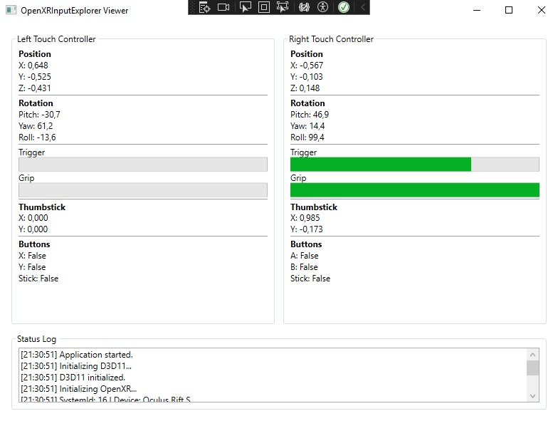

# OpenXR Input Explorer

OpenXR Input Explorer is a .NET 8 WPF application built with Silk.NET for exploring OpenXR controller input.

Originally created as a prototype for experimenting with VR controller input and motion mapping. The project evolved into a standalone OpenXR diagnostics and input exploration tool.

## Features

* OpenXR runtime initialization
* D3D11-backed OpenXR session creation
* Controller position tracking
* Controller rotation tracking
* Trigger visualization
* Grip visualization
* Oculus Touch controller bindings
* OpenXR action set examples
* Silk.NET OpenXR examples

## Technologies

* .NET 8
* C#
* WPF
* Silk.NET
* OpenXR
* Direct3D 11

## Tested Hardware

* Oculus Rift S
* SteamVR OpenXR Runtime

## Screenshot



## Building

Requirements:

* Visual Studio 2022
* .NET 8 SDK
* OpenXR Runtime (SteamVR tested)

Build:

```powershell
dotnet build
```

Run:

```powershell
dotnet run
```

## Future

- Implement an **OpenXR API Layer** to observe OpenXR controller input from running OpenXR applications without interfering with normal runtime operation

## Status

Experimental project created for learning and exploring OpenXR controller input in .NET.
